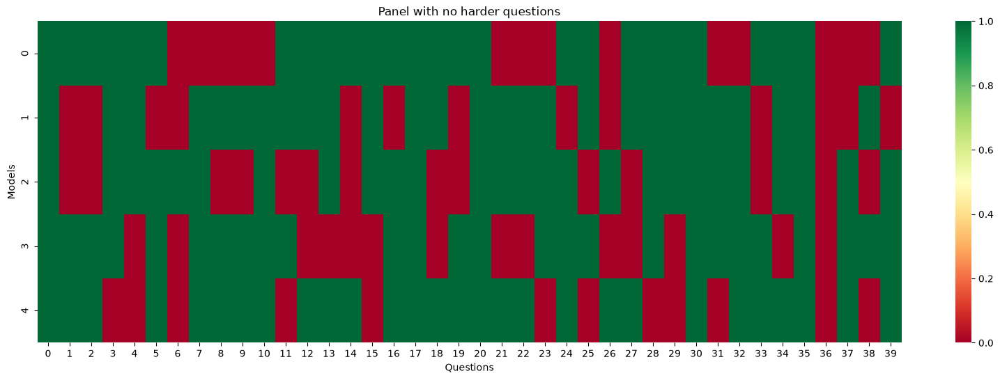
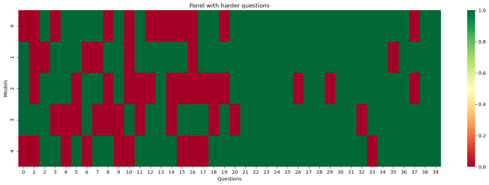

# A Small Simulation
The author simulated two panels of five models where each model gets answer correctly 70% of the time. Assumption:
- The models mentioned in this simulation is not LLM model, because you can't configure an LLM model to be correct 70% of the time. Instead, the model used here is a random number picker that picks random umber from 1-10 (inclusive) and it gets "right" when it lands on 1-7 (inclusive)

In the first panel, each model's mistakes land independently of the others. In the second panel, the mistakes overlap. Assumption:
- In the first panel, all questions' difficulty level is 70&. A model gets right when it chooses a number from 1-7 (inclusive) for all questions.
- In the second panel, half of the questions' difficulty is 90%, and the other half's is 50%.
  - This will still lead to 70% correct rates in a single model. (0.5 * 0.9) + (0.5 * 0.5) = 0.7 (following law of total probability)

Results:
1. First Panel

2. Second Panel

In the second panel, the error for all models tend to happen within the first half of the questions, which had a harder criteria of models being right. While in the first panel, errors are independent of another. In both panels, each model had the same 70% correct rates. 
Takeaway: Adding new model with the same chance of being wrong in the same question does not help models make correct decision through voting.